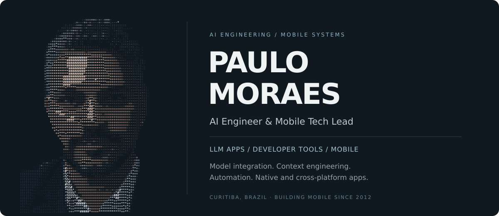

  

# Paulo Moraes

**AI Engineer · Senior Mobile Software Engineer · Technical Lead**

I build AI-powered developer tools and automation systems, with hands-on ownership of model integration, context engineering, structured outputs, application architecture, and delivery.

Through Probox Studio, I develop products that put AI into practical workflows. Code Reviewer brings contextual analysis into pull-request review, connecting models to source code, repository context, review tools, and editable findings. My work connects models to the data, tools, interfaces, and failure-handling paths an application needs.

That work builds on my mobile engineering background: Android since 2012, iOS since 2015, and Flutter since 2019. I've developed native applications, reusable SDKs, and hardware integrations across banking, mobility, healthcare, retail, and digital publishing.

I'm currently a Mobile Tech Lead at Movida and run Probox Studio alongside my client engagements. I stay involved in implementation, architecture, debugging, code reviews, mentoring, and release delivery.

[Portfolio](https://www.proboxstudio.com.br) · [LinkedIn](https://www.linkedin.com/in/paulo-e-r-moraes/) · [Email](mailto:paulo.moraes@proboxstudio.com.br) · [Code Reviewer](https://github.com/studiopaulomoraes/Probox-CodeReviewer-releases)

[AI engineering](#ai-engineering) · [Products](#ai-products-and-independent-work) · [Technologies](#technologies) · [Experience](#selected-engineering-experience) · [Writing](#writing-and-education)

## AI engineering

My AI work centers on application engineering: building the model integrations, context pipelines, output contracts, and user workflows around LLMs. I work across Kotlin and Python, from desktop developer tools to scheduled automation.

### Model integration and context engineering

- **Multi-provider integration:** Connect OpenAI, Gemini, Anthropic, and Grok to a shared product workflow, with model selection, provider-specific behavior, and configurable reasoning effort.
- **Context assembly:** Combine code diffs, related source files, attached documentation, pull-request descriptions, technical stacks, and reviewer instructions so analysis has relevant engineering context.
- **Bounded context handling:** Retrieve related files with limits on file count, payload size, and concurrent fetches. Split large review inputs into batches and handle provider rate limits and retries.
- **Structured model responses:** Use JSON Schema and Pydantic validation to turn semantic matching into typed application data that can be persisted, filtered, and reviewed.
- **Human review:** Present AI findings alongside the code and keep review comments editable before publication, so engineers can inspect and refine the result.

### Workflow orchestration and reliability

- Build pipelines that ingest information, normalize and deduplicate records, prepare model requests, validate responses, and synchronize results with external tools.
- Handle provider failures, timeouts, quotas, and malformed output through explicit failure paths and configurable fallback behavior.
- Keep domain rules separate from provider adapters using Clean / Hexagonal Architecture, making the application testable without live model calls.
- Connect model-driven workflows to Gmail, Trello, local persistence, scheduling, desktop interfaces, and release automation.

### AI-assisted software engineering

I also work with specification-driven development, project-specific agent rules, reusable agent skills, and multi-agent coordination. My skills inventory includes RAG and domain knowledge organization; in my products, context grounding includes repository guidance, documentation, and related source code.

I bring the same engineering practices to AI work that I use in mobile systems: clear boundaries, automated tests, observability, failure recovery, and reviewable outputs.

## AI products and independent work

### Code Reviewer

[Public releases and downloads](https://github.com/studiopaulomoraes/Probox-CodeReviewer-releases)

I own the product architecture, implementation, and delivery of a desktop code-review application for macOS, Windows, and Linux.

- Built the shared application with Kotlin Multiplatform and Compose Multiplatform, using Ktor, Koin, Kotlin Serialization, Coroutines, and shared presentation logic.
- Integrated pull-request APIs from GitHub, GitLab, Azure DevOps, and Bitbucket, with diff navigation, review discussions, and draft comments.
- Integrated OpenAI, Gemini, Anthropic, and Grok for contextual code analysis, including provider selection, reasoning effort, and project-specific technical context.
- Built context assembly, related-file retrieval, large-input batching, and retry handling around the analysis workflow. Kept AI review comments editable as drafts before publication.
- Added Sentry observability and automated multi-OS builds, package validation, release publishing, and update manifests with GitHub Actions.

### Probox Studio Portfolio

[Explore the portfolio](https://www.proboxstudio.com.br)

I built the portfolio itself as a Flutter Web application, using Clean Architecture, Modular, and BLoC/Cubit. It brings together my career, technical skills, publications, and project work, with automated validation, tests, build, and deployment.

The current codebase also uses Firebase services including AI Logic, App Check, Remote Config, Analytics, and Crashlytics, alongside bloc_test and Mocktail for testing.

## Engineering focus

- **Architecture and SDK design:** Module boundaries, dependency injection, reusable components, native bridges, and APIs that other applications can integrate and maintain.
- **Hardware and platform integration:** BLE device discovery, connection state, reconnection, session recovery, sensors, firmware updates, cameras, and platform-specific behavior.
- **Production quality:** Performance profiling, startup measurement, crash and ANR investigation, automated tests, and regression prevention.
- **Delivery and technical leadership:** Architecture decisions, code reviews, mentoring, reusable CI/CD pipelines, signing, packaging, and store releases.
- **AI product engineering:** Model integrations, context assembly, validated outputs, provider adapters, and automated workflows connected to external systems.

## Technologies

The tools below reflect work across different products and stages of my career.

| Area | Technologies and practical experience |
| --- | --- |
| **AI application engineering** | OpenAI, Gemini, Anthropic, Grok, context engineering, structured outputs, model/provider integration, batching, retries and configurable fallback |
| **Python and automation** | Python, Pydantic, JSON Schema, SQLite, Typer, uv, pytest, Ruff, Pyright, Gmail and Trello integrations |
| **AI-assisted development** | RAG and knowledge organization, specification-driven development, agent rules, reusable skills and multi-agent workflows |
| **Android** | Kotlin, Java, Jetpack Compose, XML Views, Android Jetpack, Coroutines, Flow, Hilt, Koin, Gradle, build variants and product flavors |
| **iOS** | Swift, Objective-C, SwiftUI, UIKit, AVFoundation, AVPlayer, Alamofire, CocoaPods, Swift Package Manager, signing and provisioning |
| **Flutter** | Dart, Flutter Web, Modular, BLoC/Cubit, Riverpod, Provider, GetX, GoRouter, design systems, flavors, Freezed and build_runner |
| **Kotlin Multiplatform** | Compose Multiplatform, Compose Desktop, Ktor, Koin, Kotlin Serialization, shared ViewModels, Coroutines, Flow and desktop packaging |
| **Architecture** | Clean Architecture, MVVM, MVI, modularization, SDK architecture, repository and use-case boundaries, unidirectional data flow and SOLID |
| **APIs and data** | REST, GraphQL, Apollo Kotlin, Retrofit, OkHttp, Dio, Room, SQLite, DataStore, Realm, Protobuf, offline-first persistence and synchronization |
| **Native and hardware integration** | BLE, GPS, accelerometer, gyroscope, NFC, NDK/JNI, CameraX, ML Kit, OCR, liveness, Flutter Platform Channels, Pigeon and React Native native modules |
| **Media and monetization** | ExoPlayer/Media3, AVPlayer, Amazon IVS, hybrid WebViews, Ads SDKs, Google Mobile Ads, Prebid, Amazon APS, Play Billing and Ads measurement |
| **Testing and performance** | JUnit, Espresso, Robolectric, MockK, Mockito, Compose UI tests, flutter_test, bloc_test, Mocktail, Kover, coverage gates, Baseline Profiles, Macrobenchmark and profiling |
| **Delivery and observability** | GitHub Actions, Azure DevOps, GitLab CI/CD, Bitbucket Pipelines, Jenkins, Fastlane, SonarQube, Firebase App Distribution, Crashlytics, Sentry and Avo |
| **Firebase and security** | Authentication, Firestore, FCM, Remote Config, AI Logic, App Check, Hosting, SSL pinning, secure storage and biometric authentication |

My React Native experience is centered on Android/iOS native modules and hardware bridges. Android, iOS, Flutter, and Kotlin Multiplatform are the main platforms I develop in.

## Selected engineering experience

### The Philadelphia Inquirer, through Curotec — Senior Android Developer

Worked on a production news application in an international team, contributing to native mobile modernization, architecture, performance, and release quality. The engagement concluded in October 2026.

- Developed Audio Stories on Android with native playback, a persistent player, media notifications, lifecycle handling, and integration with hybrid article content.
- Instrumented feed impressions and clicks with Avo to support consistent engagement measurement.
- Implemented Baseline Profiles and Macrobenchmark coverage for reproducible startup measurement and performance-regression analysis.
- Reviewed changes involving deep links, navigation, concurrency, thread safety, external input, and main-thread execution. Contributed to technical discussions around Jetpack Compose, SwiftUI, Ads, and the Android/iOS experience.

**Core technologies:** Kotlin, Android, Jetpack Compose, SwiftUI, native media playback, WebViews, Avo, Baseline Profiles, Macrobenchmark.

### LuizaLabs — Senior Mobile Developer

Developed and maintained Android and iOS advertising SDKs used across the Magazine Luiza, Netshoes, and Zattini ecosystem.

- Implemented Ads measurement, including views, impressions, clicks, and fill rate, translating monetization requirements into reusable SDK capabilities.
- Contributed to SDK architecture with Clean Architecture and MVI, with attention to state management, testability, and compatibility with consuming applications.
- Investigated crashes, ANRs, and integration problems; participated in code reviews, CI/CD, trunk-based development, and controlled releases.

**Core technologies:** Android, iOS, Kotlin, Swift, mobile SDKs, AdTech, Clean Architecture, MVI, CI/CD.

### Santander / F1rst, through act digital — Senior Systems Analyst

Contributed to the Android architecture work behind a corporate-banking application revamp.

- Worked on module compilation and integration problems caused by circular dependencies and implementations supplied only by the host application.
- Helped restructure dependency injection and module boundaries so that external modules and standalone samples could become less dependent on the main app.
- Contributed to the modularization pipeline and architectural restructuring during the engagement.

**Core technologies:** Android, multi-module architecture, dependency injection, dependency management, build integration.

### Movida — Mobile Tech Lead

I lead Flutter engineering for mobility and field-service applications, covering architecture, implementation, quality, and delivery across Android and iOS.

- Work across Modular with BLoC/Cubit, Riverpod, Provider, and GetX codebases, including the evolution of existing applications and shared components.
- Build and stabilize BLE integrations with field hardware, including discovery, connection recovery, persistent sessions, and failure handling. Connect Flutter to native Android/iOS capabilities through platform bridges.
- Built the GeoFleetClient CI/CD pipeline on Azure DevOps, covering commit conventions, static analysis, style checks, SonarQube, and quality enforcement on pull requests.
- Established per-file coverage gates of at least 90% for files changed in PRs, test reporting in Azure, and code generation with Pigeon and build_runner.
- Automate APK, AAB, and IPA delivery with Fastlane, Firebase App Distribution, environment-specific releases, store publishing, and tagging. Created a reusable Flutter CI/CD template for new applications.

**Core technologies:** Flutter, Dart, Modular, BLoC/Cubit, BLE, Platform Channels, Pigeon, Protobuf, Azure DevOps, SonarQube, Fastlane, Firebase App Distribution.

### FullStack Labs — Mobile Systems Engineer

Built native Android and iOS capabilities for an international React Native healthcare product, working in English across implementation, documentation, and team collaboration.

- Developed native modules and bridges connecting the React Native application to platform APIs and medical glucose-monitoring devices.
- Implemented BLE discovery, connection, data exchange, reconnection, and recovery when hardware or operating-system state changed.
- Investigated failures across hardware, native code, and the application layer. Documented device behavior, connection flows, troubleshooting, and architectural decisions in English.

**Core technologies:** Kotlin, Swift, Android, iOS, React Native native modules, BLE, hardware integration.

### Bradesco — Senior Systems Analyst, Mobile Specialists

Worked on native platforms and reusable components for banking applications, with a primary focus on Android and participation in Android/iOS technical decisions.

- Refactored the check-deposit NDK SDK, reducing its package size from approximately **50 MB to 6 MB** while preserving existing functionality.
- Implemented CameraX, light-sensor analysis, and LUMA processing for image-capture validation.
- Built proofs of concept using NFC for ATM interactions and Firebase ML Kit for payment barcode reading.
- Evaluated platform changes affecting compatibility, security, and integration across banking applications and SDKs.

**Core technologies:** Android, Kotlin, Java, NDK/JNI, SDK architecture, CameraX, LUMA, NFC, ML Kit, unit and integration testing.

<strong>More experience: telematics, computer vision, streaming, and white-label platforms</strong>

### CEABS — Mobile Telematics and Field Hardware

Worked with CEABS through eWave and later as a direct consultant between 2016 and 2020.

- Designed and developed a white-label vehicle-telematics framework using GPS, accelerometer, and gyroscope data.
- Implemented models for trip start/end detection, sudden braking and acceleration, sharp turns, and speeding. Studied the physics behind the event-detection logic and validated behavior in the field.
- Developed Android tools for technicians, including Bluetooth communication, Protobuf messages, firmware updates, automatic reconnection, and active-session maintenance.

**Core technologies:** Native mobile SDKs, Android, GPS, motion sensors, Bluetooth, Protobuf, telemetry algorithms, firmware integration.

### M2Sys — OCR, Document Capture, and Liveness SDKs

- Designed Android and iOS SDKs for document capture, OCR, image-quality validation, facial landmarks, and liveness detection.
- Moved image-quality checks onto the device so unsuitable captures could be identified before backend submission.
- The validation work contributed to an approximately **96% reduction in manual document-image rejections**.

**Core technologies:** Android, iOS, native SDKs, image processing, OCR, camera integration, facial recognition, liveness.

### WeDoc — Flutter and Native Live Streaming

- Led Android/iOS integration with Amazon IVS for a healthcare social platform.
- Built Flutter Platform Channels around the native streaming SDKs and worked on session lifecycle, video quality, error handling, and integration stability.
- Mentored developers on Flutter/native integration, architecture, and code quality.

**Core technologies:** Flutter, Dart, Kotlin, Swift, Platform Channels, Amazon IVS, live streaming.

### Earlier Mobile Work

- **MalaPronta:** Android development and mobile technical leadership for a hospitality white-label platform, combining shared application code with branded configurations.
- **IdealSoft:** An offline-first Android field-sales application with local persistence and Windows Azure synchronization.
- **Livetouch:** Android smartphone and tablet applications, including financial-information products, with work on UI behavior, performance, and ongoing maintenance.

## How I work with teams

My technical leadership includes hands-on implementation, architectural discussions, code reviews, mentoring, and production troubleshooting. I help define boundaries between modules and platforms, make integration behavior explicit, and establish checks that support reliable releases.

I have worked with international teams using English for daily communication, technical documentation, meetings, and code reviews. Portuguese is my native language.

## Writing and education

I'm the author of **Jetpack Compose & SwiftUI for Those Who Already Know Flutter**, a technical book of more than 220 pages available in English and Portuguese. It compares components, state management, navigation, layouts, architecture, and testing across the three frameworks.

[English edition](https://www.amazon.com/dp/B0H9X1LK2G?language=en_US&currency=USD) · [Portuguese edition](https://www.amazon.com.br/dp/B0H9Y2ZPMC)

- **Postgraduate degree in Mobile Applications and Cloud Computing** — Universidade Positivo.
- **Bachelor's degree in Computer Science** — Universidade Estadual de Mato Grosso do Sul.

## Get in touch

For conversations about AI engineering, LLM applications, developer tooling, mobile systems, SDKs, or technical leadership:

[paulo.moraes@proboxstudio.com.br](mailto:paulo.moraes@proboxstudio.com.br) · [LinkedIn](https://www.linkedin.com/in/paulo-e-r-moraes/) · [Probox Studio](https://www.proboxstudio.com.br)
